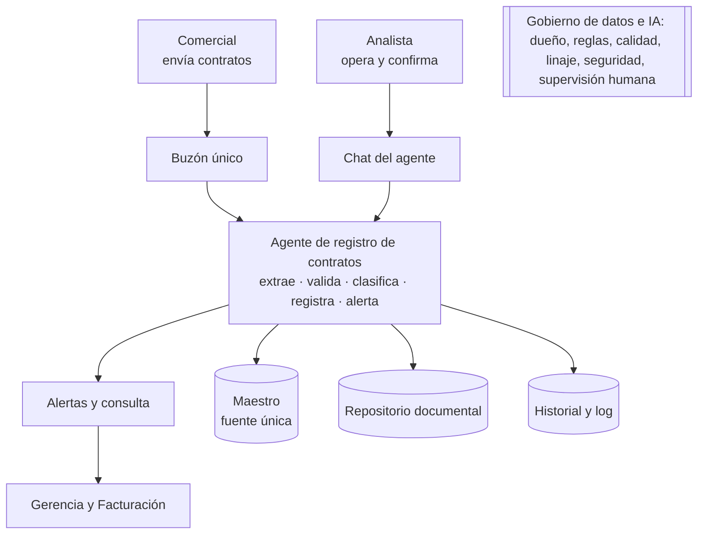
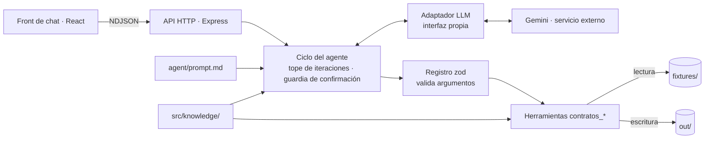

# SOLUCIÓN — Agente "Registro de Contratos Vigentes"

> Reto técnico 02 · Equipo Perxia 2.0 · Periferia IT Group
> Enfoque: tratar el maestro de contratos como un **activo de datos gobernado**, no como un Excel que alguien alimenta. El agente es el mecanismo; el gobierno es lo que hace que el proceso sobreviva a la rotación.

---

## 1. Problema en una frase

**El maestro de contratos está congelado desde el 30 de mayo de 2026. Solo llegan a administración los contratos con póliza, no hay un canal único y el proceso dependía de una persona que ya no está. Hoy la compañía no puede responder qué contratos tiene vigentes, cuáles vencen ni qué pólizas exigidas faltan.**

| A quién le duele | Cómo |
|---|---|
| Gerencia | No puede responder "¿qué vence este trimestre?" ni dimensionar el riesgo contractual. |
| Analista administrativa | Persigue contratos en correos personales y no tiene un punto de entrada ni un criterio de completitud. |
| Comerciales | No saben qué enviar ni a quién; el costo de no enviar es invisible hasta que algo falla. |
| La compañía | Pólizas exigidas que no se constituyen o vencen: exposición a incumplimientos y sanciones. |

---

## 2. Arquitectura

### 2.1 Vista conceptual

### 2.2 Vista detallada

### 2.3 Dónde vive cada cosa

| Capa | Ubicación | Qué cambia si cambia el negocio |
|---|---|---|
| **Comportamiento** | `agent/prompt.md` | Cómo conversa, en qué orden usa las herramientas, cómo pide confirmación. |
| **Conocimiento** | `src/knowledge/registro-contratos.md` (roles, reglas, diccionario) y `src/knowledge/reglas.json` (umbrales, días, fecha de corte, vocabularios) | Un cambio de regla de negocio se hace aquí. **No toca el servidor ni las herramientas.** |
| **Ejecución** | `src/tools/contratos.ts` y `src/tools/lib/` | Solo cambia si cambia el *cómo* (por ejemplo, leer PDF nativo). |

`demo.ts`, el servidor y `modulo/` usan exactamente el mismo `src/tools/contratos.ts`.

### 2.4 Zonas de datos

| Zona | Contenido | Regla |
|---|---|---|
| Cruda | Correos, adjuntos, `comerciales.json`, maestro inicial | Solo lectura (RN6) |
| Curada | Maestro, documentos archivados, historial, procesados | Solo se escribe a través de herramientas que validan; escritura atómica |
| Consumo | `alertas.md`, consulta del maestro | Se regenera, no se edita |

---

## 3. Ciclo del agente

`src/agent/ciclo.ts`:

1. Agrega el mensaje del usuario. Si la sesión superó `MAX_TOKENS_SESION`, responde sin llamar al modelo.
2. Bucle de hasta `MAX_ITERACIONES` (25): envía la conversación al modelo a través del adaptador.
   - Si el modelo no pide herramientas, esa es la respuesta del turno.
   - Si pide herramientas (puede pedir varias a la vez), por cada una: **guardia de confirmación** → validación zod de los argumentos → ejecución → resultado al historial, evento al front y línea en `out/log.jsonl`.
3. Si se agota el tope (CA1), responde con lo hecho, lo pendiente de confirmación y cómo continuar.
4. Un error del proveedor (timeout, 400, 429, 5xx) se muestra en el chat en español, con su detalle técnico, y la sesión sigue viva (CA5).

### Confirmación humana: por prompt y por diseño (CA2, CA3)

El prompt pide terminar el turno con una pregunta, pero la regla no depende de que el modelo obedezca. Tres controles en código la garantizan:

| Control | Qué impide |
|---|---|
| **Registro re-valida** | `contratos_registrar` vuelve a extraer y validar desde el archivo; si hay campos en revisión y no llega `confirmado: true`, no escribe. |
| **Linaje de valores** | El contrato final parte de la extracción. Un campo que no estaba en revisión y llega con otro valor se rechaza; solo los campos en revisión aceptan el valor que confirmó la persona. |
| **Guardia de turno** | Al iniciar cada turno, el ciclo toma una "foto" de los mensajes que quedaron pendientes en el turno anterior. `confirmado: true` solo se acepta para esos mensajes. Si el modelo intenta confirmar algo que se volvió pendiente en el mismo turno, la llamada se bloquea, se le devuelve el error y queda registrada en el log. |

`needsConfirmation` se calcula con los pendientes reales (resultados de las herramientas), no con el texto del modelo. El front muestra un banner "Requiere tu confirmación" con las respuestas sugeridas.

Cada valor del maestro queda trazado en `historial.jsonl` con su origen: `extraccion`, `maestro` (heredado en un otrosí) o `confirmacion_humana`.

---

## 4. Elección del modelo

| | |
|---|---|
| **Proveedor y modelo** | Google · `gemini-3.6-flash` (GA), configurable con `LLM_MODEL`. |
| **Por qué** | El modelo solo orquesta herramientas y redacta en español; la extracción no depende de él. Un modelo Flash es suficiente, rápido y de bajo costo. |
| **Por qué no `gemini-3.8-flash`** | Durante la construcción respondía `504 DEADLINE_EXCEEDED` incluso con un mensaje mínimo ("hola"). Se cambió con la variable de entorno, sin tocar código. |
| **Requisitos del proveedor resueltos en el adaptador** | (1) Gemini rechazaba el JSON Schema que genera zod (`$schema`, `additionalProperties`, uniones con `null`): el adaptador lo sanea antes de enviarlo. (2) Los modelos Gemini 3 exigen devolver intactas las firmas de pensamiento (`thoughtSignature`) en el historial: el adaptador guarda el contenido original del proveedor en un campo opaco que el ciclo almacena sin interpretarlo. |
| **Límites del plan gratuito** | 5 peticiones por minuto. Se mitigó agrupando las llamadas a herramientas (el modelo pide varias en una misma respuesta), con un limitador `LLM_MAX_RPM` y un reintento que respeta el tiempo que indica el proveedor, con tope de espera. Para la operación real se recomienda el plan pago. |

### Costo estimado por caso

El costo depende de los tokens que consume cada lote. Cada llamada al modelo envía el prompt de sistema, el conocimiento y las definiciones de las herramientas, más el historial acumulado; cada contrato agrega al historial el resultado de extraer, validar y registrar.

**Costo por caso = (tokens de entrada × Pentrada + tokens de salida × Psalida) ÷ 10⁶**, con P en USD por millón de tokens según la tarifa vigente del modelo.

El consumo real queda registrado por sesión en `/api/sessions/:id` (`uso.entrada`, `uso.salida`). **[verificar: anotar aquí el consumo medido al procesar el lote de 6 mensajes y dividirlo entre 6]**

Palancas si el volumen crece: agrupar llamadas (ya aplicado), cache de contexto del proveedor para el prefijo fijo, resumir resultados de herramientas antes de devolverlos al modelo, y procesar el buzón por lotes programados dejando el chat solo para las confirmaciones.

---

## 5. Estrategia de extracción

**Principio: el modelo orquesta, la herramienta extrae.** Todo valor que llega al maestro sale de código determinista y auditable (`src/tools/lib/extraccion.ts`) o de una persona.

| Campo | Cómo se encuentra |
|---|---|
| Documento | Se recorren **todos** los adjuntos de `correo.json` (los fixtures oficiales traen `contrato.txt`, `otrosi.txt` y `cotizacion.txt`) y se decide por el contenido si es contrato, otrosí o no-contrato. |
| `id_contrato` | Número del encabezado ("No. CT-2026-015", "Contrato Marco No. CM-2026-03"). En un otrosí, el del contrato que modifica. Sin número → `AUTO-<año>-<secuencia>`. |
| Partes | Razón social de la contraparte (nunca Periferia), normalizada al formato del maestro. |
| `nit_cliente`, `pais` | Identificador tributario sin puntos ni dígito de verificación; el país sale del tipo y la longitud del identificador. |
| `objeto` | Cláusula OBJETO, máximo 200 caracteres. |
| `valor`, `moneda` | **Solo de la cláusula de valor**, nunca de la de garantías (en msg-006 la cláusula de garantías menciona COP 100.000.000 y no se toma). "Valor no determinado", "por demanda" u "órdenes de servicio" → 0 con `valor_indeterminado`. Sin moneda en la cláusula → se infiere del país. Moneda fuera de la lista → error, no se adivina. |
| Fechas | Cláusula de plazo. Si el plazo se cuenta desde la firma, se usa la fecha de firma; si la firma solo trae mes y año, el último día de ese mes. Plazo en meses → por calendario, mismo día del mes final. |
| Pólizas | Cláusula de garantías del contrato. Una exigencia condicional cuenta como exigida. Los tipos se escriben con los mismos valores del maestro (`cumplimiento`, `calidad`, `salarios_prestaciones`, `responsabilidad_civil`, `estabilidad_obra`). |
| Fuente | **El contrato manda sobre el correo.** El cuerpo del correo solo orienta; un dato que solo aparece ahí no supera la confianza "inferido". |

### Cómo se calcula la confianza

Por **tipo de evidencia**, con niveles parametrizados en `reglas.json`:

| Nivel | Valor | Cuándo | ¿Revisión? |
|---|---|---|---|
| Etiquetado | 0.95 | El dato está bajo su etiqueta o en el encabezado | No |
| Patrón | 0.90 | Patrón fuerte fuera de etiqueta | No |
| Inferido | 0.85 | Deducido de pistas consistentes | No |
| Derivado | 0.70 | Calculado (fecha fin por meses) | **Sí** |
| Ambiguo | 0.60 | Varios candidatos o valor por demanda | **Sí** |
| Ausente | 0 | No está en el texto | **Sí** |

Además, `contratos_validar` envía a revisión los **conflictos con el maestro** y las **incoherencias** (fin antes de inicio, póliza exigida sin tipo). Cada campo trae la **evidencia textual** que se muestra al pedir confirmación.

### Dónde entra el modelo y dónde no

| El modelo SÍ | El modelo NO |
|---|---|
| Decide el orden de las herramientas y cuándo detenerse | Extrae, calcula ni corrige valores |
| Redacta la tabla, el resumen de alertas y las preguntas de confirmación | Cambia un valor extraído (lo impide el linaje) |
| Interpreta la respuesta de la persona y la traduce a los campos en revisión | Confirma por su cuenta (lo impide la guardia de turno) |

---

## 6. Regla de gobierno

> **RG-CON-01 · Registro único de contratos vigentes**
> Dueño: Coordinación Administrativa y Financiera · Aplica a: equipo comercial, administración y Facturación · Vigencia: desde su publicación · Revisión: semestral.

**Principio:** un contrato existe para la compañía solo si está registrado en el maestro de contratos. El problema de fondo no es técnico: el maestro se congeló porque dependía de una persona y porque nadie estaba obligado a enviar los contratos sin póliza. El agente automatiza el registro, pero esta regla es la que hace que el proceso sobreviva a la rotación.

**Roles**

| Rol | Quién | Responsabilidad |
|---|---|---|
| Dueño del dato | Coordinación Administrativa y Financiera | Aprueba reglas y excepciones, resuelve conflictos y responde por el indicador. Responde la pregunta abierta del PRD: sin área legal, el dueño es quien responde por el riesgo financiero de vigencias y pólizas. |
| Administradora | Analista administrativa | Opera el buzón y el agente, confirma los datos dudosos y gestiona las pólizas con el corredor. |
| Productor | Comercial que firma | Envía el contrato y sus novedades completos y a tiempo. |
| Patrocinador | Gerencia Comercial | Hace cumplir la regla en su equipo y atiende los escalamientos. |
| Control | Facturación | Verifica el registro antes de la primera factura y entrega el cruce mensual. |
| Custodio | TI | Buzón, almacenamiento, permisos, respaldo y clave del modelo. |

**1. Canal único.** Todos los contratos se envían a un único buzón, `contratos@periferia…` **[confirmar dirección]**, administrado por la analista administrativa. Un contrato enviado por otro medio debe reenviarse al buzón, y el plazo se cuenta desde ese momento.

**2. Obligación del comercial**
- **Qué:** el contrato firmado por ambas partes con sus anexos de valor o tarifas, todo otrosí, las actas de inicio, terminación y liquidación, y las pólizas cuando las reciba. **Todos los contratos, tengan o no póliza.**
- **Plazo:** máximo 3 días hábiles desde la última firma.
- **Asunto:** `[CONTRATO|OTROSÍ|ACTA|PÓLIZA] Cliente - Número de contrato`.

**3. Acuse automático.** En producción, el agente revisa el buzón cada 15 minutos y responde al comercial en menos de una hora hábil con el radicado, el resultado (registrado, actualizado, duplicado, rechazado o en revisión), los datos extraídos para que los verifique y, si quedó en revisión, qué dato genera duda y por qué.

**4. Excepciones y escalamiento**

| Situación | Qué pasa | Se escala a | Plazo |
|---|---|---|---|
| Contrato sin firmar | Se devuelve como "pendiente de firma" y no se registra | Gerente Comercial | 5 días hábiles |
| Sin valor o por demanda | Se registra con valor 0 después de que la analista lo confirme | — | 2 días hábiles |
| Dato dudoso (confianza menor a 0.8) | No se registra hasta que la analista lo confirme | Dueño del dato | 2 días hábiles |
| Remitente no registrado | Se registra sin comercial y se avisa para incluirlo en la lista | Gerencia Comercial | 2 días hábiles |
| Otrosí sin contrato base | Se rechaza y se pide el contrato original | Dueño del dato | 3 días hábiles |
| Otrosí que amplía el plazo de un contrato con póliza | La póliza pasa a pendiente hasta que se amplíe (RN8) | Analista con el corredor | Antes del vencimiento |
| Póliza pendiente más de 15 días | Aparece en alertas | Dueño del dato | Revisión semanal |

**5. Cierre del gap de junio a agosto de 2026 (una campaña de dos semanas)**
1. Facturación entrega la lista de clientes facturados entre el 31 de mayo y el 31 de agosto de 2026.
2. Se cruza con el maestro por NIT: lo facturado que no está registrado es la lista de contratos faltantes, asignada a cada comercial.
3. Cada comercial reenvía sus contratos al buzón con el asunto `[MIGRACION]`; el agente los registra con `fuente = migracion`.
4. Al cierre se repite el cruce, y lo que siga faltando se escala a la Gerencia Comercial con nombre propio.
5. La Gerencia Comercial certifica que su cartera quedó completa.

**Control que hace cumplir la regla:** desde la certificación, Facturación no emite la primera factura de un contrato que no esté en el maestro. Es la misma lógica que apliqué en un proyecto anterior de gestión contractual: si solo se digitaliza el proceso, se digitaliza el problema; hay que convertir el registro en un requisito previo, no en un favor.

**6. Indicador mensual**

> **Cobertura del maestro** = contratos facturados en el mes que están registrados ÷ total de contratos facturados en el mes. **Meta: 98 % o más.**

Demuestra que el proceso vive, porque la facturación ocurre aunque nadie registre el contrato. Indicadores de apoyo: días entre firma y registro (meta: 3 hábiles o menos), porcentaje registrado sin revisión manual, pólizas pendientes por más de 15 días y completitud de los datos obligatorios (el anexo de calidad de `alertas.md` ya la calcula).

---

## 7. Decisiones y trade-offs

| # | Decisión | Alternativa descartada | Por qué |
|---|---|---|---|
| D1 | **Extracción determinista** con confianza por tipo de evidencia; el modelo no extrae. | Extraer con el modelo. | Resultado reproducible y auditable, sin costo por contrato, y sin riesgo de que el modelo "redondee" valores. Costo: es más sensible a redacciones muy distintas; se mitiga con vocabularios en `reglas.json` y enviando a revisión todo lo que no sea etiquetado. |
| D2 | **Confirmación garantizada en código** (linaje + guardia de turno), además del prompt. | Confiar solo en el prompt. | La regla más crítica del caso no puede depender de que el modelo obedezca. |
| D3 | **Adaptador de proveedor propio** que sanea los esquemas y preserva las firmas de pensamiento. | Acoplar el ciclo al SDK de Gemini. | Los requisitos propios de Gemini se resolvieron sin tocar el ciclo; cambiar de modelo fue cambiar una variable. |
| D4 | **Herramienta `contratos_descartar`** para duplicados y rechazados. | Que `contratos_registrar` también cierre duplicados. | Semántica clara: registrar solo escribe. Sin ella, duplicados y rechazados reaparecerían en cada lectura del buzón. |
| D5 | **Reglas de negocio en `reglas.json`** (umbrales, días, fecha de corte, vocabularios). | Constantes en el código. | Un cambio de regla no toca el servidor y queda bajo control del dueño del dato. |
| D6 | **Llamadas agrupadas y limitador de ritmo.** | Una llamada al modelo por herramienta. | Reduce las llamadas por lote y respeta el límite del plan gratuito (5 por minuto). |
| D7 | **Otrosí archivado junto al original**, con la extensión real del adjunto. | Sobrescribir el documento. | Se conserva el original y cada versión queda trazada. |
| D8 | **Express** para la API. | Servidor HTTP propio. | Estándar de Node y compatible con el entorno de AI Studio y Cloud Run. |

---

## 8. Supuestos

1. **Fixtures oficiales.** Se usaron los fixtures entregados por Periferia. Los adjuntos no siempre se llaman `contrato.txt` (`otrosi.txt`, `cotizacion.txt`), así que el documento se identifica por su contenido.
2. **Firma sin día.** Si el plazo se cuenta desde la firma y esta solo indica mes y año, la fecha de inicio es el último día de ese mes (criterio conservador). Caso msg-006: "agosto de 2026" → 2026-08-31.
3. **Plazo en meses.** Se cuenta por calendario y termina el mismo día del mes final. Caso msg-006: 2026-08-31 + 12 meses → 2027-08-31. Como es un valor calculado, va a confirmación humana.
4. **Póliza condicional.** Un contrato que exige póliza solo para algunas órdenes de servicio se registra con `requiere_poliza = true` y estado pendiente, para que no quede fuera del seguimiento. Caso msg-006.
5. **Valor de un otrosí.** Si el otrosí fija un nuevo valor total, ese es el valor; si adiciona un monto, se suma al anterior. Caso msg-003: fija PEN 520.000.
6. **Herencia en otrosíes.** Lo que el otrosí no menciona se hereda del maestro con origen `maestro`.
7. **Reenvío con cambios.** Un reenvío con el mismo número y valores distintos que no es otrosí se trata como actualización con conflicto, que requiere confirmación.
8. **Remitente no registrado.** El contrato se registra con la columna `comercial` vacía y una advertencia; nunca se guarda el correo como comercial. Caso msg-006.
9. **Registrados desde el corte.** Son los contratos con `fecha_registro` posterior al 2026-05-30.
10. **Fecha de referencia.** `fecha_registro` es la fecha real de procesamiento; la fecha de referencia de la demo (2026-09-03) solo aplica a las alertas.
11. **Almacenamiento en el despliegue.** En Cloud Run el disco es temporal: `out/` se reinicia si el servicio se reinicia. Es aceptable para la demostración; en producción el maestro pasa a una lista de SharePoint o una base gestionada.

---

## 9. Cobertura

| Historia | Estado | Evidencia | Falta para producción |
|---|---|---|---|
| HU-1 Leer buzón | Hecho | `contratos_leer_buzon`; excluye procesados y marca los mensajes sin contrato | Conector a Exchange vía Microsoft Graph |
| HU-2 Extraer | Hecho | Esquema 7.2 con confianza y evidencia por campo; ausentes en `null` con 0 | Lectura de PDF nativo (P1) y OCR para escaneos |
| HU-3 Validar | Hecho | RN1–RN4, conflictos, coherencia; remitente desconocido no bloquea | Maestro de clientes con alias |
| HU-4 Registrar | Hecho | Escritura atómica, archivo, historial con origen por campo, procesados, RN8 | Lista de SharePoint con control de concurrencia |
| HU-5 Alertar | Hecho | Tres secciones y anexo de calidad; fecha de referencia por argumento | Envío programado a gerencia (correo o Teams) |
| HU-6 Errores | Hecho | Las herramientas nunca lanzan; mensajes en español; el lote continúa | — |
| CA1–CA5 | Hecho | `npm run test:ciclo` | — |
| Front, API, adaptador, prompt aparte | Hecho | `src/App.tsx`, `src/server.ts`, `src/llm/`, `agent/prompt.md` | Autenticación con identidad corporativa |
| `demo.ts` | Hecho | 6 mensajes, segunda pasada confirmada, casos malos **[verificar: ejecutado en local]** | — |
| Bonus `modulo/` | Hecho | Generado de las mismas fuentes; `npm run modulo:check` **[verificar]** | — |
| `contratos_leer_pdf` (P1) | No hecho | — | Librería de extracción de texto de PDF |
| Link público | Hecho | Cloud Run con clave de acceso **[verificar]** | — |

---

## 10. Uso de IA

Usé tres asistentes con roles distintos, y en todos los casos revisé, probé y decidí qué se quedaba.

| Asistente | Para qué lo usé | Qué decidí yo |
|---|---|---|
| **Claude (Anthropic)**, en claude.ai | Análisis del PRD, diseño de la solución.También generó una implementación de referencia que usé **solo como oráculo de resultados esperados**, no como código entregado.
| **Gemini en Google AI Studio (Build mode)** | Construcción del código por bloques: esqueleto, reglas, extracción, validación, registro, alertas, ciclo del agente, adaptador, API y chat. | Revisé cada bloque contra el PRD antes de aceptarlo y lo probé en la vista previa con los fixtures oficiales. |
| **Gemini `gemini-3.6-flash`** | Modelo del agente en ejecución: orquesta las herramientas y redacta las respuestas. | Lo limité a orquestar: no extrae ni modifica valores y no puede confirmar por su cuenta. |
| **ChatGPT`** |Diagramar arquitecturas (conceptual, detallada y de datos)

**Lo que descarté o corregí de lo que propuso la IA**

| Propuesta | Por qué la descarté o corregí |
|---|---|
| Argumentos inventados en `leer_buzon` (límite y filtro) | El PRD define su entrada vacía. |
| Descripción de `validar` como "coherencia jurídica" | El PRD excluye explícitamente la revisión jurídica (sección 2.3). |
| Usar siempre la fecha de firma para el plazo | Solo vale cuando el contrato dice que el plazo se cuenta desde la firma; definí la regla del último día del mes cuando la firma no tiene día. |
| Calcular el estado de la póliza y el comercial en la extracción | Corresponden al registro y a la validación; separé las funciones. |
| Guardar el correo del remitente como comercial | Un remitente no registrado se reporta como advertencia y la columna queda vacía (HU-3). |
| Marcar como "del buzón" las filas por la columna `fuente` | El maestro oficial ya traía filas con esa fuente; ahora se marcan por fecha de registro e historial. |
| Archivar el otrosí con extensión `.pdf` | Se conserva la extensión real del adjunto. |
| Fecha del sistema fija en 2026-09-03 | La fecha real es la del servidor; la de la demo la da la persona. |
| Afirmar que la demo estaba "validada" sin ejecutarla | Verifiqué el flujo en la vista previa con los fixtures oficiales. |
| Mostrar un error 400 como "servicio caído" | Corregido para mostrar el detalle real; la causa era que Gemini rechazaba el esquema de las herramientas. |
| Interpretar mal el tiempo de espera de la cuota (40.065 s) | Corregido el cálculo, con tope de espera y mensaje claro de cuota agotada. |
| Usar `gemini-3.8-flash` | Daba 504 incluso en llamadas mínimas; lo cambié por `gemini-3.6-flash` desde una variable, sin tocar código. |

Puedo explicar cada línea entregada, y las verificaciones (demo, prueba del ciclo, tipos y sincronía del módulo) las ejecuté antes de entregar. **[confirmar al correr la demo en local]**

---

## 11. Riesgos de llevar esto a producción

| Riesgo | Mitigación |
|---|---|
| Redacciones de contrato muy distintas a las previstas | Todo lo que no esté etiquetado va a revisión: el sistema falla hacia la persona, no hacia el dato malo. Medir el porcentaje de revisión por campo y enriquecer `reglas.json`. |
| PDF escaneados | OCR antes de extraer, con la confianza de todo texto OCR limitada a "inferido" para forzar revisión. |
| Cuota y disponibilidad del modelo | Plan pago en producción, limitador de ritmo, reintentos con tope y mensajes claros. El proveedor se cambia con una variable gracias al adaptador. |
| Cambios del proveedor (formatos de esquema, firmas de pensamiento) | Encapsulados en el adaptador; el ciclo no conoce detalles de Gemini. |
| Falsos duplicados o falsos nuevos por variaciones del cliente | Dedupe por NIT antes que por nombre; maestro de clientes con alias. |
| Instrucciones escondidas en correos o contratos | El contenido se trata como dato; las herramientas no ejecutan comandos; los valores pasan por esquema y linaje; la confirmación no la puede dar el modelo. |
| Concurrencia y persistencia | Hoy: escritura atómica y una sesión ocupada por turno; en Cloud Run, una sola instancia. En producción: lista de SharePoint o base gestionada con control de versiones. |
| Uso indebido del link y costo | Clave de acceso, topes de iteraciones y tokens, y límite de longitud del mensaje. |
| Datos personales en contratos | No se extraen datos de firmantes; el log guarda resúmenes, no el texto completo. Retención definida para las sesiones. |
| Que la regla no se cumpla | Control preventivo en facturación, indicador de cobertura mensual y campaña con certificación de la Gerencia Comercial. Sin esto, el agente solo registra lo que le llega, igual que hoy. |
